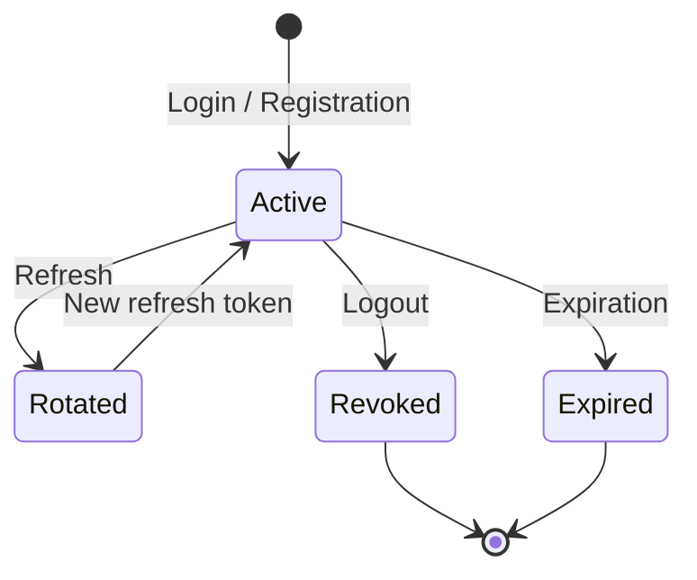

# Authentication Architecture

## 1. Scope

این سند طراحی احراز هویت فعلی را توصیف می‌کند. Authentication هویت را مشخص می‌کند؛ Authorization تعیین می‌کند کاربر به چه منابعی دسترسی دارد.

## 2. Current Design

Hybrid JWT + database-backed session:

- Access Token: JWT کوتاه‌عمر، در پاسخ JSON.
- Refresh Token: مقدار تصادفی، در HttpOnly cookie.
- Database: فقط Hash مربوط به Refresh Token ذخیره می‌شود.
- Session: وضعیت انقضا و لغو در دیتابیس نگهداری می‌شود.
- Role: از دیتابیس خوانده می‌شود، نه از ادعای ارسالی Client.

تنظیم فعلی طراحی: Access Token حدود ۱۵ دقیقه و Refresh Token حدود ۷ روز. مقادیر واقعی باید با Environment و کد زمان اجرا تطبیق داده شوند.

## 3. Access Token

Payload مفهومی:

```json
{
  "userId": "user-id",
  "sessionId": "session-id"
}
```

Client آن را در Header می‌فرستد:

```http
Authorization: Bearer <access-token>
```

JWT به‌تنهایی کافی نیست؛ Middleware وضعیت Session و User را هم بررسی می‌کند.

## 4. Refresh Token

Cookie باید در Production حداقل ویژگی‌های زیر را داشته باشد:

- `HttpOnly`
- `Secure`
- `SameSite` متناسب با معماری Client/API
- `Path` محدود به مسیرهای Auth در صورت سازگاری با مسیرها
- `Max-Age` و `Expires` مطابق زمان انقضا

Refresh باید به‌صورت Rotation انجام شود. توکن قبلی پس از Rotation نباید مجدداً پذیرفته شود.

## 5. Session Lifecycle



در پیاده‌سازی Rotation باید رفتار درخواست‌های هم‌زمان Refresh نیز مشخص و تست شود.

## 6. OTP

- OTP باید با مولد تصادفی رمزنگارانه تولید شود.
- مقدار خام OTP ذخیره نشود.
- Hash با Secret سروری و روش مناسب مانند HMAC-SHA256 تولید شود.
- انقضا، حداکثر تلاش، cooldown و محدودیت درخواست اعمال شود.
- OTP موفق فقط یک بار مصرف شود.
- پیامک در Production از Provider واقعی ارسال شود.
- Mock Provider فقط برای Development باشد.

## 7. Registration Flow

1. Client درخواست OTP ثبت‌نام می‌کند.
2. سرور Challenge ایجاد و پیامک ارسال می‌کند.
3. Client اطلاعات ثبت‌نام و OTP را ارسال می‌کند.
4. سرور ورودی را اعتبارسنجی و Challenge را تأیید می‌کند.
5. User با Role پیش‌فرض Patient و PatientProfile ایجاد می‌شود.
6. Session ساخته و Tokenها صادر می‌شوند.

ایجاد User، مصرف Challenge و ایجاد Session باید در Transaction واحد یا طراحی معادل اتمیک انجام شود.

## 8. Current Status

پیاده‌سازی و تست دستی گزارش‌شده:
- ثبت‌نام Patient با OTP.
- Email/password login.
- `/me`.
- Refresh rotation.
- Logout و رد Session لغوشده.
- رد ورود با رمز اشتباه، ایمیل ناشناخته و حساب غیرفعال.

نیازمند تکمیل:
- OTP Login.
- Password Reset.
- Phone/Email verification مستقل.
- تست خودکار و سناریوهای race/concurrency.
- Rate limiting، CSRF/CORS review و سخت‌سازی Production.
