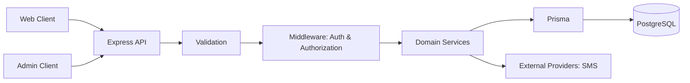

# System Architecture Overview

## 1. هدف

این سند نمای سطح بالای معماری Pezeshki را توضیح می‌دهد. جزئیات اجرایی هر ماژول باید در سند تخصصی خودش ثبت شود.

## 2. Repository Layout

```text
Pezeshki/
├── apps/
│   ├── api/       # Backend HTTP API
│   ├── web/       # Patient-facing web application
│   └── admin/     # Administration application
├── packages/
│   └── types/     # Shared TypeScript types/contracts
└── docs/          # Architecture, API and operational docs
```

## 3. Main Components

### API

مسئول:
- احراز هویت و مجوزها.
- منطق کسب‌وکار.
- اعتبارسنجی درخواست‌ها.
- دسترسی به PostgreSQL از طریق Prisma.
- ارائه قرارداد HTTP برای Web و Admin.

Stack شناخته‌شده: Express 5، TypeScript، Prisma 7 و PostgreSQL.

### Web

رابط کاربری اصلی برای بیماران و در صورت تصمیم محصول، صفحات عمومی پزشکان.

### Admin

رابط مجزا برای عملیات مدیریتی و نظارت بر کاربران، پزشکان و تخصص‌ها.

### Shared Types

قراردادهای TypeScript مشترک. این package نباید جایگزین اعتبارسنجی runtime در API شود؛ ورودی‌های HTTP باید در سرور اعتبارسنجی شوند.

## 4. Logical Domains

- Identity & Access: User، OTP، Session، Role و Permission.
- Doctor: پروفایل حرفه‌ای، تخصص و وضعیت تأیید.
- Patient: پروفایل و اطلاعات شخصی.
- Scheduling: برنامه هفتگی، استثناها و Slotهای آزاد.
- Appointment: رزرو و چرخه وضعیت نوبت.
- Medical Records: سوابق، حساسیت‌ها و داروها.
- Visit & Prescription: ویزیت، تشخیص و نسخه.
- Administration: مدیریت و ممیزی عملیات.

این تقسیم‌بندی دامنه‌ای است؛ لزوماً به معنی وجود همین تعداد پوشه یا ماژول در کد فعلی نیست.

## 5. High-level Request Flow



## 6. Architectural Rules

1. Controllerها مسئول HTTP concerns باشند؛ منطق اصلی در Serviceها قرار گیرد.
2. اعتبارسنجی ورودی در مرز API انجام شود.
3. دسترسی دیتابیس از مسیر مشخص و قابل تست انجام شود.
4. منطق مجوز در هر درخواست محافظت‌شده اعمال شود.
5. عملیات حساس چندمرحله‌ای از Transaction استفاده کنند.
6. API responseها ساختار پایدار و مستند داشته باشند.
7. خطاهای داخلی و جزئیات Secretها به Client نشت نکنند.
8. زمان‌ها با timezone مشخص ذخیره و نمایش داده شوند.

## 7. Decisions Requiring Confirmation

- قرارداد نهایی API و نسخه‌بندی آن.
- سیاست timezone برای پزشک و بیمار.
- سیاست حذف/ناشناس‌سازی حساب و داده پزشکی.
- سیاست نگهداری و دسترسی به Audit Log.
- نیاز به صف برای SMS و اعلان‌ها.
- روش پرداخت و سیاست مالی، در صورت اضافه شدن به دامنه محصول.
