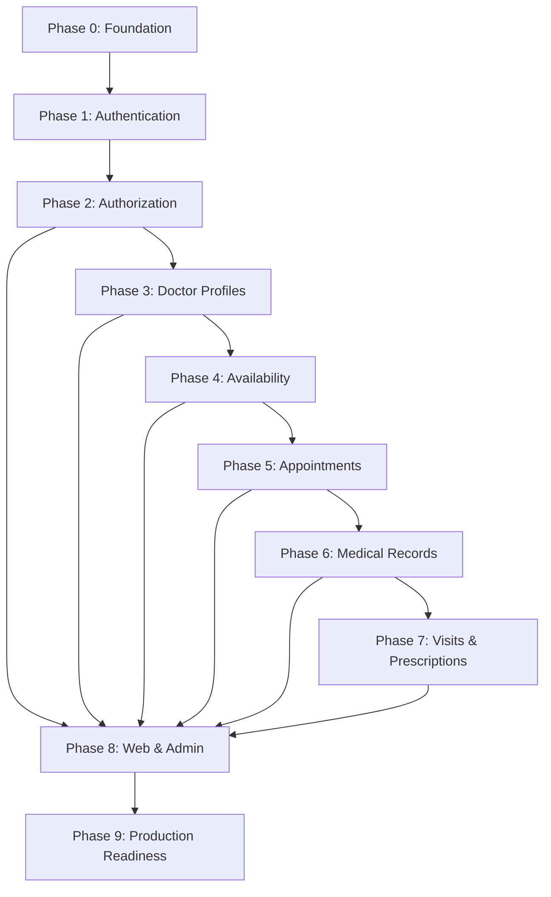

# Pezeshki — Product & Engineering Roadmap

**نوع سند:** نقشه راه فنی و محصول  
**وضعیت:** پیشنهادی و قابل بازبینی  
**آخرین بازبینی:** 2026-11-07

## 1. چشم‌انداز محصول

Pezeshki یک سامانه نوبت‌دهی پزشکی با سه سطح اصلی کاربری است:

- **Patient:** جستجوی پزشک، مشاهده زمان‌های آزاد، رزرو نوبت و مشاهده سوابق شخصی.
- **Doctor:** مدیریت پروفایل، تخصص، برنامه حضور، نوبت‌ها، ویزیت‌ها و نسخه‌ها.
- **Admin:** مدیریت کاربران، پزشکان، تخصص‌ها و نظارت بر عملکرد سامانه.

رابط کاربری فارسی و راست‌به‌چپ (RTL) است. برنامه‌های Web و Admin جدا از API توسعه داده می‌شوند.

## 2. اصول هدایت‌کننده

1. ابتدا قراردادها و مدل داده، سپس منطق کسب‌وکار و در نهایت UI وابسته به آن توسعه یابد.
2. هر فاز باید معیار پذیرش روشن و تست‌پذیر داشته باشد.
3. دسترسی به داده‌های پزشکی باید حداقلی، مجاز و قابل ممیزی باشد.
4. رزرو نوبت باید در برابر درخواست‌های هم‌زمان ایمن باشد.
5. عملیات چندمرحله‌ای حساس باید از تراکنش دیتابیس استفاده کنند.
6. داده‌های حساس، رمزها، OTPها و Tokenها نباید در Log یا Git ثبت شوند.
7. قابلیت‌های Planned نباید در مستندات به‌عنوان Implemented معرفی شوند.

## 3. وضعیت فعلی

| حوزه | وضعیت | توضیح |
|---|---|---|
| Monorepo و Workspaceها | Implemented / بازبینی لازم | ساختار `apps/*` و `packages/*` موجود است |
| PostgreSQL و Prisma | Partial / migration pending | اعتبارسنجی schema موفق؛ یک migration در DB توسعه pending و migration بزرگ قبلی نیازمند بازبینی است |
| Patient registration با OTP | Implemented / دستی تست شده | ساخت User و PatientProfile و Session |
| Email/password login | Implemented / integration-tested | جریان موفق و رد درخواست‌های نامعتبر پوشش داده شده |
| Access JWT و Session middleware | Implemented / integration-tested | اعتبارسنجی Session و وضعیت حساب |
| Refresh rotation | Implemented / integration-tested | Rotation، reuse rejection و race test |
| Logout و لغو Session | Implemented / integration-tested | Access و Refresh قبلی پس از لغو رد می‌شوند |
| OTP Login | Implemented / automated integration test | OTP مصرف‌شده، malformed و استفاده مجدد رد می‌شوند |
| تست خودکار Auth | Partial / 19 passing | چهار فایل تست پاس؛ Reset/Phone Verification و تست‌های production hardening ندارند |
| Authorization & User Management | Partial (’infrastructure done) | policy پایه، self-profile، file owner-only، admin account status، contact verification، appeal scaffolding؛ endpointهای Appointment/Clinical باز هستند |
| Doctor / Appointment | Partial | Doctor directory, specialty, credential, admin review APIهای پیاده و تست‌شده؛ Appointment هنوز در نقشه راه |
| Frontend workflowها | Planned / در حال توسعه مستقل | نیازمند اتصال به APIهای پایدار |

## 4. فازهای توسعه

### Phase 0 — Project Foundation

**هدف:** تثبیت ساختار توسعه، قراردادهای مشترک و محیط محلی.

کارها:
- [x] تثبیت npm workspaces و اسکریپت‌های ریشه.
- [x] مستندسازی راه‌اندازی پروژه.
- [x] تثبیت TypeScript configuration و typecheck; lint script موجود است.
- [x] ثبت قواعد مدیریت Environment و Secretها.
- [ ] تأیید migrationهای موجود و وضعیت دیتابیس؛ سیاست backup/restore و دستورات مستند شده‌اند.

**معیار تکمیل:**
- توسعه‌دهنده بتواند پروژه را طبق README راه‌اندازی کند.
- Build برنامه‌ها از دستورات مستندشده قابل اجرا باشد.
- هیچ Secret در Git نباشد.

**وضعیت اجرا (2026-11-07):** build و typecheck موفق؛ lint ناموفق به‌علت نبود فایل `@typescript-eslint/eslint-plugin/dist/index.js` در نصب محلی. `prisma validate` موفق، اما `prisma migrate status` گزارش داد migration `20261104220451_add_auth_otp_sessions` هنوز pending است. migration قبلی (76 KB) دارای تغییرات destructive است و نباید بدون بازبینی/backup روی داده موجود اعمال شود. هیچ `.env` واقعی tracked نیست؛ فایل‌های نمونه شامل مقدار placeholder و credential توسعه محلی‌اند. به‌علت migration pending و lint repair، Phase 0 **Partial / blocked برای بسته‌شدن** است.

### Phase 1 — Authentication & Session Foundation

**هدف:** هویت کاربر و چرخه پایه ورود/خروج.

کارها:
- [x] درخواست OTP برای ثبت‌نام با Mock SMS.
- [x] ثبت‌نام Patient با OTP.
- [x] ساخت PatientProfile در جریان ثبت‌نام.
- [x] Hash رمز عبور با bcrypt.
- [x] Email/password login.
- [x] صدور Access JWT.
- [x] ذخیره Hash مربوط به Refresh Token در دیتابیس.
- [x] Session validation و account active check.
- [x] Refresh Token rotation.
- [x] Logout و revoke کردن Session.
- [x] تکمیل OTP Login.
- [ ] تکمیل Password Reset و Phone Verification.
- [x] تست‌های خودکار جریان‌های موجود و تست‌های منفی پایه (4 files / 19 tests passed).
- [ ] Rate limiting سطح HTTP و کنترل سوءاستفاده (OTP دارای cooldown و سقف روزانه است).
- [x] تنظیم CORS بر اساس allowlist و بررسی Cookieهای HttpOnly/SameSite/Secure.
- [x] تست هم‌زمانی Refresh و OTP replay؛ race در ایجاد challenge متزامن و unique conflict mapping همچنان نیازمند تکمیل است.
- [ ] بازبینی/پیاده‌سازی CSRF protection برای refresh با Cookie پیش از production و نهایی شدن معماری client.

**معیار تکمیل:**
- مسیرهای موفق و ناموفق با تست خودکار پوشش داده شوند.
- Tokenهای منقضی، مصرف‌شده و لغوشده پذیرفته نشوند.
- رفتار هم‌زمانی Refresh و OTP بررسی شود.
- هیچ Secret یا کد OTP در Logهای Production نباشد.

**وضعیت Phase 1:** **Partial / در حال تکمیل**. مسیرهای فعلی ثبت‌نام/ورود و session پاس هستند، اما Password Reset، Phone Verification، HTTP rate limit، CSRF production review و بعضی race/unique-constraintها باز هستند؛ Phase 1 را هنوز نمی‌توان کامل اعلام کرد.

### Phase 2 — Authorization & User Management

**هدف:** تعریف مجوزهای قابل اتکا و مدیریت چرخه عمر حساب.

کارها:
- [x] طراحی پایه Role Guard و Permission policy برای endpointهای فعلی Auth.
- [x] API پایه پروفایل کاربر فعلی با ownership مبتنی بر session و فیلدهای قابل ویرایش محدود.
- [x] مدیریت فعال/غیرفعال‌سازی حساب توسط Admin با reason، audit، لغو session و حفاظت آخرین Admin فعال.
- [x] فهرست کاربران Admin با فیلتر role/status، cursor pagination و فیلدهای حداقلی.
- [x] API فایل private با کنترل مالکیت برای خود مالک؛ مجوزهای رابطه درمانی هنوز وجود ندارد.
- [x] API پایه پروفایل Doctor با مالکیت مبتنی بر هویت احرازشده و فیلدهای قابل ویرایش allowlist شده.
- [ ] تکمیل ماتریس دسترسی Patient / Doctor / Admin برای ماژول‌های Appointment/Clinical/Admin review (definitive در policy.ts، route/endpoint در Phase 3+).
- [ ] جلوگیری از دسترسی کاربر به منابع متعلق به دیگران در ماژول‌های Doctor/Appointment/Medical Records (بدون endpoint دامنه‌ای قابل اجرا نیست).
- [x] تکمیل User Profile API و سیاست‌های verification برای اطلاعات تماس (contact/send-otp + verify).
- [ ] تکمیل workflow lifecycle حساب (appeal bone-arrastre در policy+service+controller+route، migration pending؛ MFA/strong auth و role transition audited باز هستند).
- [x] ثبت AuditLog برای تغییر وضعیت حساب توسط Admin.
- [x] تست منفی دسترسی عمودی برای Admin endpoints و دسترسی افقی برای self-profile و private files.

**معیار تکمیل:**
- هر Endpoint محافظت‌شده نقش و مالکیت منابع را بررسی کند.
- تغییر Role فقط از مسیر مجاز مدیریتی انجام شود.
- تست‌های منفی برای دسترسی غیرمجاز وجود داشته باشد.
- برای هر resource domain جدید (appointments, medical records, doctor resources)، مالکیت/رابطه دسترسی قبل از افزودن endpoint تعریف و جداگانه تست شود.

**پیشرفت (2026-11-11):** policy پایه，self-profile，فهرست و status management توسط Admin، audit و file owner-only checks پیاده‌سازی شده‌اند. API پروفایل Doctor نیز به‌صورت `/api/doctor/profile/me` اضافه شده است: lookup/update فقط بر اساس `userId` session, allowlist فیلدها, رد دسترسی غیر-Doctor و read-only بودن پروفایل‌های APPROVED/SUSPENDED. Unit و DB integration testها role denial, isolation مالکیت و status lock را پوشش می‌دهند. **Phase 2 核心框架已完成**: 权限矩阵扩展到 contact/appeal/appointment/clinical 声明层; `utils/ownership.ts` 提供所有权校验与自动 AuditLog; Contact Verification 双通道落地; Appeal 骨架就位(测试因 migration pending skip); Admin audit 增强。Appointment/Medical Records 领域端点尚未实现,IDOR 保护需在 Phase 3+ 分批闭合。MFA / Admin 强认证 / role transition 仍需产品安全决策。**结论:** Phase 2 策略层与基础设施已就绪进入验收;业务域 IDOR 视后续阶段推进分批闭合。Phase 1 仍为 Partial。

### Phase 3 — Medical Specialties & Doctor Profiles

**هدف:** ایجاد اطلاعات تخصص و پروفایل حرفه‌ای پزشک.

کارها:
- [x] طراحی Specialty و ارتباط پزشک با تخصص.
- [x] طراحی DoctorProfile.
- [x] فیلدهای معرفی، سوابق حرفه‌ای و اطلاعات مطب.
- [x] وضعیت تأیید پزشک و گردش کار بررسی توسط Admin.
- [x] API مدیریت پروفایل پزشک.
- [x] API فهرست و جزئیات پزشکان.
- [x] فیلتر بر اساس تخصص و وضعیت تأیید.
- [x] API مدیریت تخصص و مدارک پزشک.

**معیار تکمیل:**
- پزشک فقط پروفایل مجاز خود را ویرایش کند.
- پزشک تأییدنشده در جستجوی عمومی نمایش داده نشود، مگر سیاست محصول خلاف آن باشد.
- داده‌های تخصصی دارای اعتبارسنجی و تست باشند.

**پیشرفت (2026-11-13):** APIهای عمومی فهرست و جزئیات پزشک (`/api/doctors`, `/api/doctors/:doctorId`) با فیلتر تخصص/شهر/جستجو و نمایش فقط پزشکان APPROVED و منتشرشده. APIهای مدیریت تخصص و مدارک پزشک (`/api/doctors/specialties`, `/api/doctors/credentials`) با کنترل نقش DOCTOR. گردش کار بررسی پزشک توسط Admin (`/api/admin/doctors/review` و `PATCH /api/admin/doctors/:doctorId/review`) با ثبت AuditLog. تست‌های واحد و DB برای directory و review اضافه شد.

### Phase 4 — Availability & Scheduling

**هدف:** تعریف زمان‌های کاری و زمان‌های قابل رزرو.

کارها:
- [ ] طراحی برنامه هفتگی تکرارشونده.
- [ ] پشتیبانی از چند بازه کاری در یک روز.
- [ ] تعریف مدت Slot؛ مقدار پیش‌فرض محصول یک ساعت است اما بهتر است قابل تنظیم باشد.
- [ ] تعریف تعطیلات و استثناهای روزانه.
- [ ] تعریف منطقه زمانی برای مطب/پزشک.
- [ ] تولید زمان‌های آزاد برای بازه تاریخی مشخص.
- [ ] جلوگیری از تداخل برنامه‌ها و استثناها.

**معیار تکمیل:**
- زمان‌های آزاد از برنامه هفتگی و استثناها به‌درستی محاسبه شوند.
- تغییر ساعت تابستانی و timezone به‌صورت صریح مدیریت شود.
- تست مرزی برای ابتدا/انتهای بازه‌ها وجود داشته باشد.

### Phase 5 — Appointment Booking

**هدف:** چرخه کامل رزرو و مدیریت نوبت.

کارها:
- [ ] جستجوی پزشک و مشاهده زمان‌های آزاد.
- [ ] رزرو نوبت توسط Patient.
- [ ] وضعیت‌های Appointment و انتقال‌های مجاز.
- [ ] لغو نوبت و سیاست مهلت لغو.
- [ ] تغییر زمان نوبت.
- [ ] مشاهده نوبت‌های آینده و گذشته.
- [ ] مدیریت نوبت توسط Doctor و Admin.
- [ ] ثبت تاریخچه تغییرات مهم.

**معیار تکمیل:**
- دو درخواست هم‌زمان نتوانند یک Slot را دوبار رزرو کنند.
- یکپارچگی با Transaction و قیدهای دیتابیس تضمین شود.
- تمام انتقال‌های وضعیت تست شوند.
- سیاست لغو و تغییر زمان مستند باشد.

### Phase 6 — Patient Medical Records

**هدف:** نگهداری امن اطلاعات پزشکی بیمار.

کارها:
- [ ] سوابق بیماری و شرایط پزشکی.
- [ ] حساسیت‌ها.
- [ ] داروهای مصرفی فعلی.
- [ ] سابقه پزشکی و یادداشت‌های مرتبط.
- [ ] کنترل دسترسی مبتنی بر رابطه درمانی و مجوز.
- [ ] ثبت Audit Log برای مشاهده/تغییر اطلاعات حساس.

**معیار تکمیل:**
- بیمار فقط اطلاعات مجاز خود را ببیند.
- پزشک فقط در چارچوب رابطه و مجوز معتبر به اطلاعات دسترسی داشته باشد.
- عملیات خواندن و تغییر داده‌های حساس قابل ممیزی باشد.

### Phase 7 — Visits, Diagnoses & Prescriptions

**هدف:** ثبت فرآیند ویزیت و خروجی درمانی.

کارها:
- [ ] ثبت Visit و وضعیت حضور.
- [ ] ثبت شرح حال و یادداشت پزشک.
- [ ] ثبت تشخیص.
- [ ] ثبت Prescription.
- [ ] ثبت دارو، مقدار، دفعات، مدت و دستور مصرف.
- [ ] امکان مشاهده نسخه‌های قبلی با مجوز.
- [ ] نسخه قابل چاپ/خروجی در صورت نیاز محصول.

**معیار تکمیل:**
- نسخه به ویزیت و پزشک مربوط باشد.
- تغییرات مهم ثبت شوند.
- دسترسی بیمار و پزشک مطابق سیاست محرمانگی باشد.

### Phase 8 — Web & Admin Applications

**هدف:** تکمیل تجربه کاربری فارسی و RTL روی API پایدار.

کارها:
- [ ] Design system و کامپوننت‌های مشترک.
- [ ] Landing و صفحات معرفی.
- [ ] Register / Login / OTP.
- [ ] Patient dashboard.
- [ ] Doctor dashboard.
- [ ] جستجو و صفحه جزئیات پزشک.
- [ ] انتخاب تاریخ و Slot و رزرو.
- [ ] مدیریت پروفایل و برنامه پزشک.
- [ ] Admin dashboard و مدیریت کاربران/پزشکان.
- [ ] مدیریت حالت‌های Loading، Empty، Error و Success.
- [ ] دسترس‌پذیری و واکنش‌گرایی.

**معیار تکمیل:**
- جریان‌های اصلی از ابتدا تا انتها روی محیط تست اجرا شوند.
- RTL، تاریخ و زمان محلی، خطاها و اعتبارسنجی فرم‌ها بررسی شوند.
- UI به‌جای اتکا به داده ساختگی، از API واقعی استفاده کند.

### Phase 9 — Production Readiness

**هدف:** آماده‌سازی برای استقرار قابل اتکا.

کارها:
- [ ] تست واحد، Integration و End-to-End.
- [ ] بازبینی امنیتی و dependencyها.
- [ ] Docker image و محیط‌های مجزا.
- [ ] مدیریت Secretها.
- [ ] Logging ساختاریافته و حذف داده حساس از Log.
- [ ] Health checks و Monitoring.
- [ ] Backup و آزمایش Restore.
- [ ] CI pipeline و بررسی Build/Test.
- [ ] مستندات Deployment و Rollback.
- [ ] تست بار و بررسی عملکرد queryها.

**معیار تکمیل:**
- استقرار از pipeline تکرارپذیر باشد.
- Backup واقعاً قابل Restore باشد.
- مانیتورینگ خطاهای حیاتی را آشکار کند.
- فرآیند Rollback مستند و آزمایش شده باشد.

## 5. وابستگی فازها

این نمودار ترتیب مفهومی را نشان می‌دهد؛ برخی کارهای Frontend می‌توانند هم‌زمان با توسعه API و با قراردادهای تثبیت‌شده پیش بروند.

## 6. Definition of Done

هر قابلیت زمانی Done محسوب می‌شود که:

- [ ] ورودی‌ها و خروجی‌های آن مشخص باشند.
- [ ] اعتبارسنجی ورودی انجام شود.
- [ ] مجوز و مالکیت منابع بررسی شود.
- [ ] خطاهای قابل انتظار مدیریت شوند.
- [ ] تست‌های مرتبط نوشته و اجرا شده باشند.
- [ ] migrationها بررسی و قابل اعمال باشند.
- [ ] مستندات API و معماری به‌روز باشند.
- [ ] Logها حاوی Secret یا داده حساس غیرضروری نباشند.
- [ ] Build و بررسی‌های CI موفق باشند.

## 7. نحوه به‌روزرسانی Roadmap

- Checkboxها فقط پس از تکمیل و بررسی معیار پذیرش علامت زده شوند.
- وضعیت واقعی هر فاز در جدول وضعیت ثبت شود.
- تغییر ترتیب فازها باید با دلیل فنی/محصولی همراه باشد.
- این Roadmap برنامه قطعی زمانی نیست؛ اولویت‌ها با بازخورد و ریسک‌های فنی بازبینی می‌شوند.
